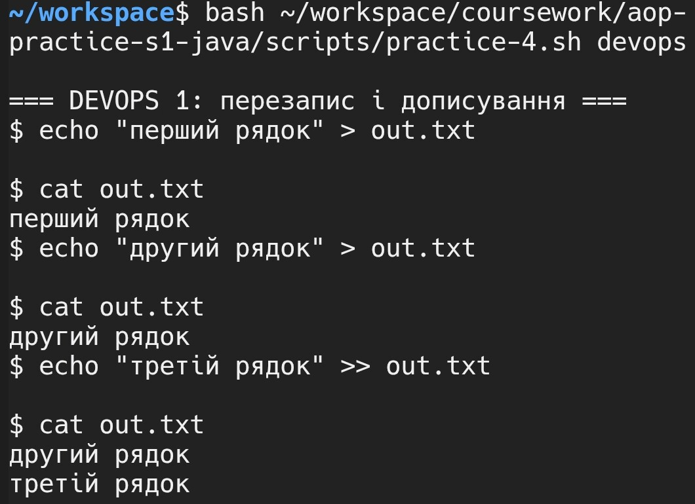
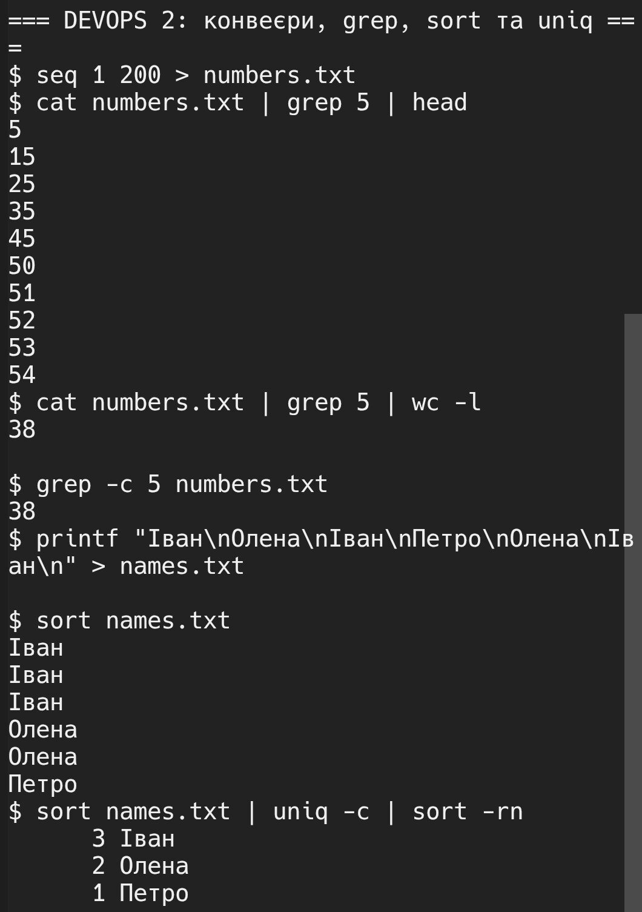
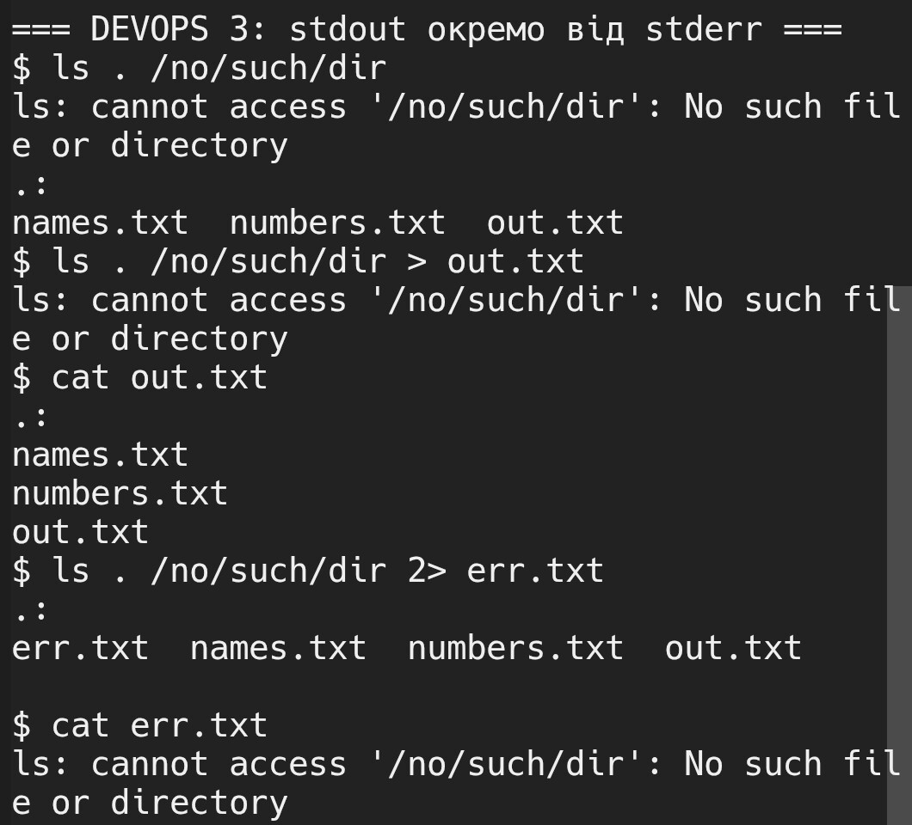
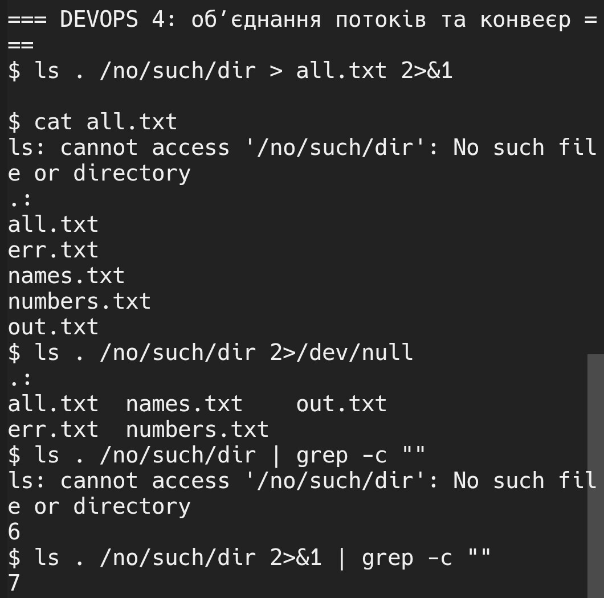
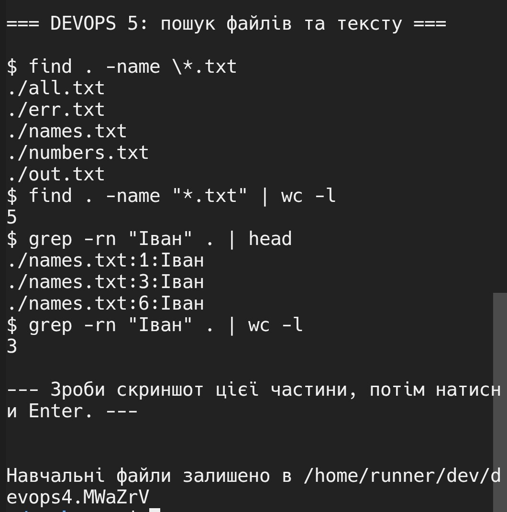

# Практична 4 — підтвердження виконання

Скриншоти отримано під час виконання завдань зі смартфона. Панелі телефона й браузера
обрізано; команди, справжній вивід і результати перевірки не змінювалися.

## LeetCode

### 461 — Hamming Distance

Результат: **Accepted, 149/149 тестів**.

### 476 — Number Complement

Результат: **Accepted, 154/154 тести**.

## Git

Навчальний remote — локальний bare-репозиторій у тимчасовій теці, а не новий
репозиторій GitHub. Усі матеріали практичної здаються в основному особистому репозиторії.

### 1. Початковий push, адреси remote та tracking

### 2. Навмисно відхилений push

Віддалена копія вже містить інший коміт. Git правильно відхиляє push з локальної копії,
яка ще не отримала ці зміни. Це очікуваний результат вправи, а не незавершена помилка.

### 3. Успішне злиття, граф історії та push

Після отримання змін `git pull --no-rebase` створив merge-коміт. Наступний push
виконано успішно. Повідомлення про очікування редактора не зупинило команду:
нижче видно завершене злиття та надсилання комітів.

### 4. Додатковий remote, fetch, видалення remote та конфігурація

### 5. Завершення сценарію

## DevOps

Опис і сценарій: [перенаправлення, конвеєри та потоки](devops-4.md).

### 1. Перезапис і дописування

`>` перезаписує вміст файла, а `>>` додає рядок до наявного вмісту.

### 2. Конвеєри, grep, sort та uniq

Обидва способи підрахунку рядків із цифрою `5` дають **38**.
Сортування й підрахунок повторів імен дають: Іван — 3, Олена — 2, Петро — 1.

### 3. Окреме перенаправлення stdout і stderr

Помилка про відсутню `/no/such/dir` викликана навмисно для перевірки потоків:
`>` перенаправляє звичайний вивід, а `2>` — повідомлення про помилку.

### 4. Об'єднання потоків і конвеєр

`2>&1` об'єднує stderr зі stdout. Без об'єднання конвеєр рахує **6** рядків,
а з повідомленням про помилку — **7**. Перенаправлення `2>/dev/null` приховує помилку.

### 5. Пошук файлів і тексту, завершення сценарію

Знайдено **5** текстових файлів та **3** рядки з іменем «Іван».
Унизу показано завершення сценарію й розташування навчальних файлів.

