# Практична 5 — підтвердження виконання

Справжні скриншоти зі смартфона обрізано до вмісту LeetCode і термінала:
панелі телефона та браузера не включені.

## LeetCode

### 1913 — Maximum Product Difference Between Two Pairs

**Accepted — 96/96 тестів.**

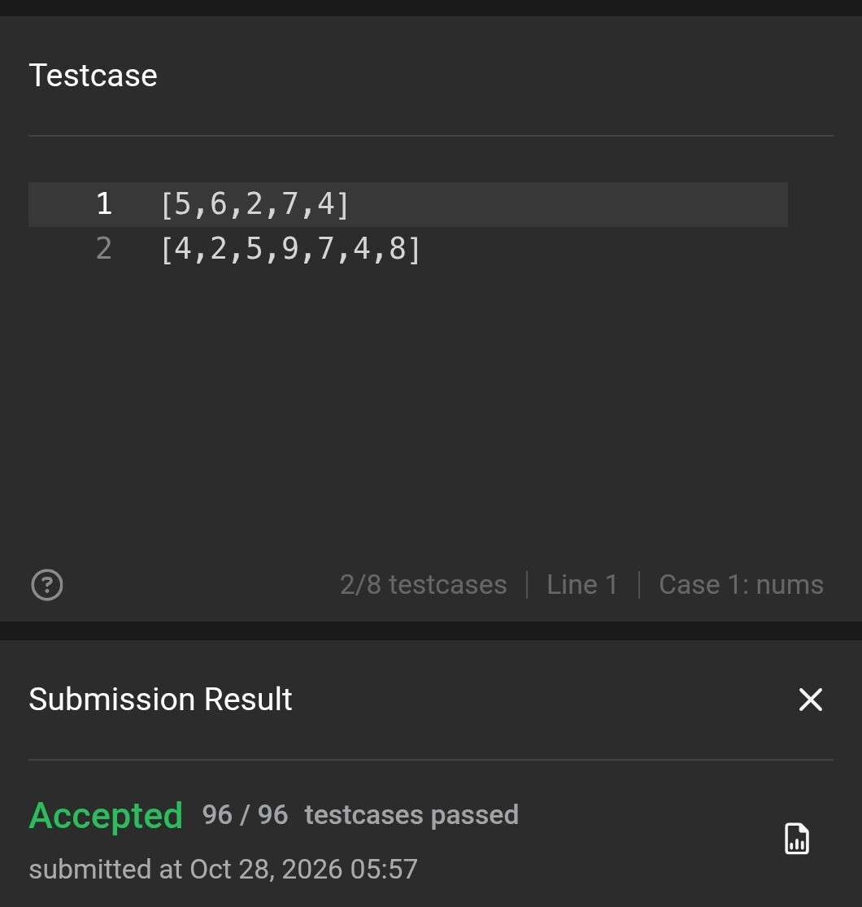

### 977 — Squares of a Sorted Array

**Accepted — 137/137 тестів.**

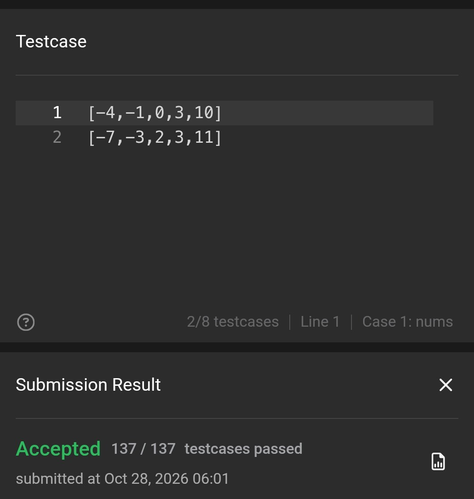

## DevOps

Усі п'ять частин виконано: змінні й лапки; shebang та аргументи; права доступу;
`set -euo pipefail`; скрипт підрахунку файлів.

### 1. Змінні та лапки

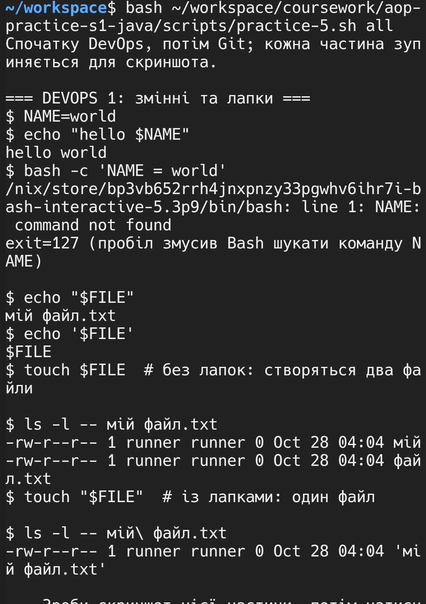

### 2. Shebang, аргументи й права на виконання

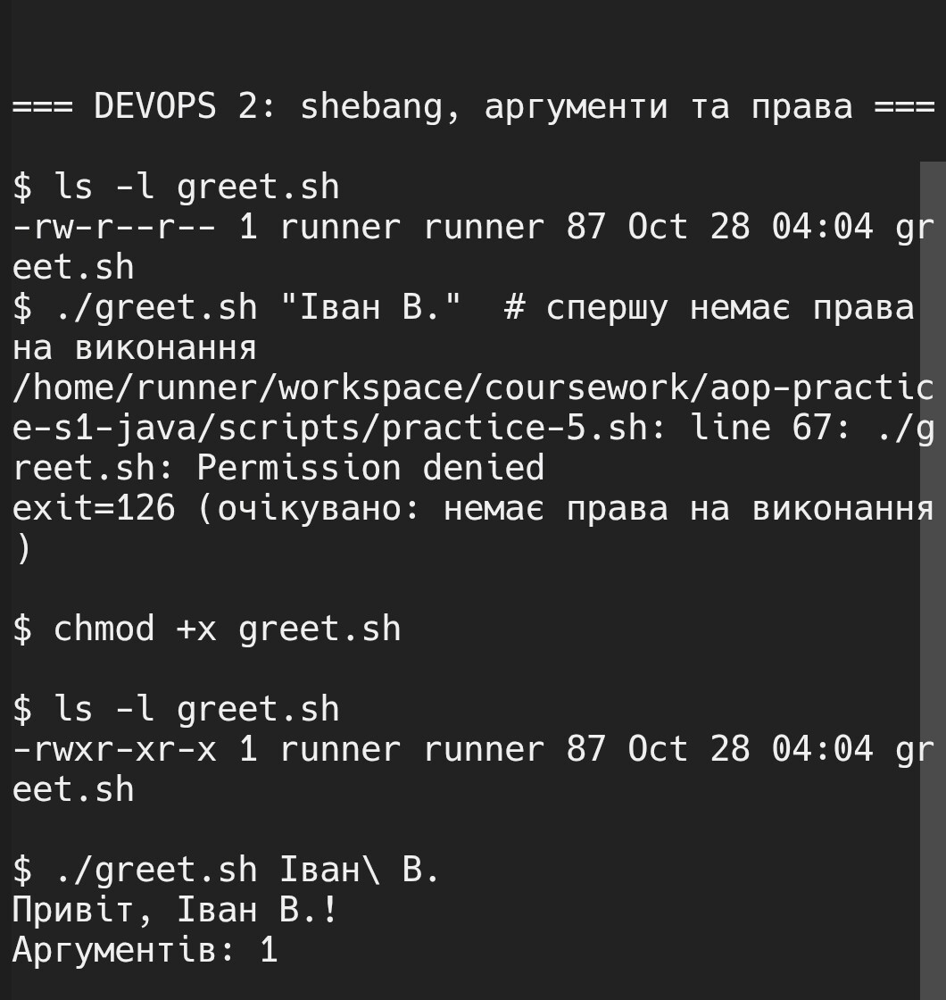

### 3. `./script.sh` і `bash script.sh`

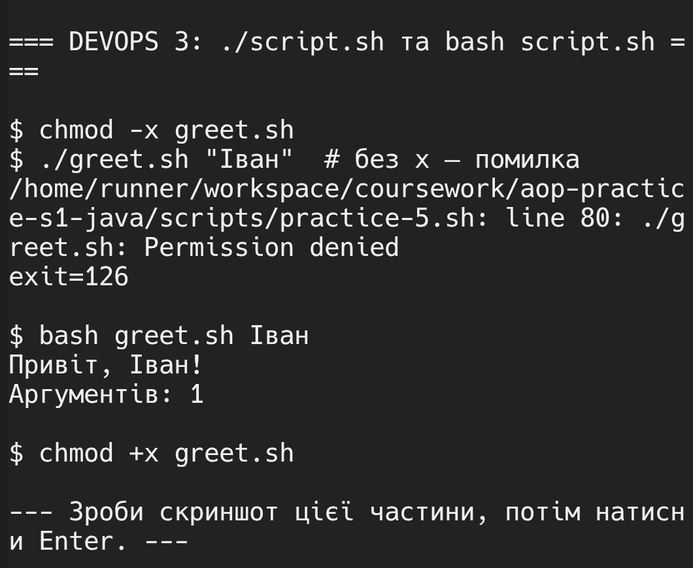

### 4. Безпечна зупинка після помилки

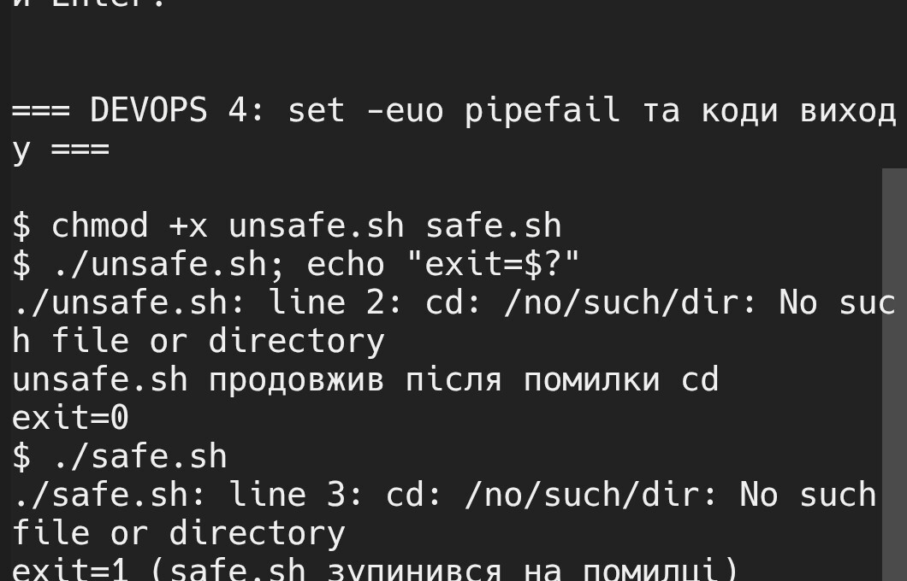

### 5. `set -u` і підрахунок файлів за розширенням

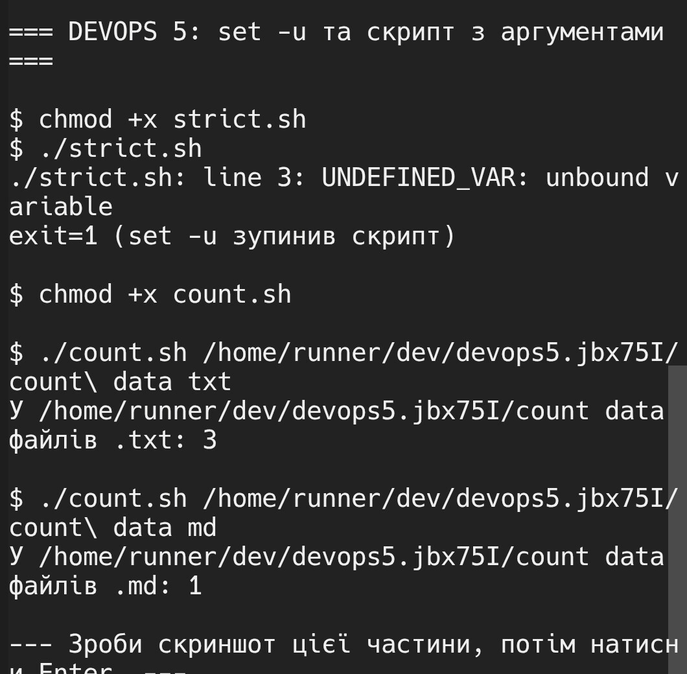

## Git

Демонстрація виконана в окремому тимчасовому репозиторії; справжні дані й історія
репозиторію GitHub не змінювалися. Значення в прикладі `.env` є фальшивим.

### 1. Ігнорування збірки та локальних налаштувань

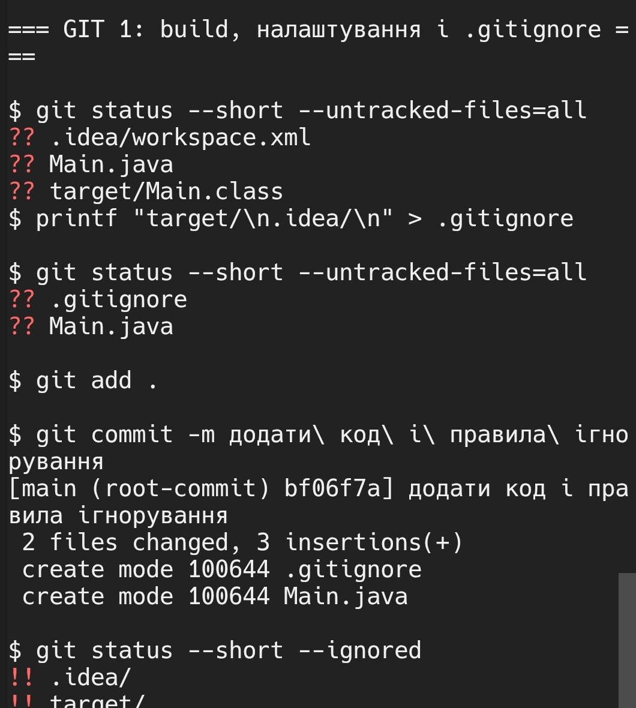

### 2. `.env`: відстеження та `git rm --cached`

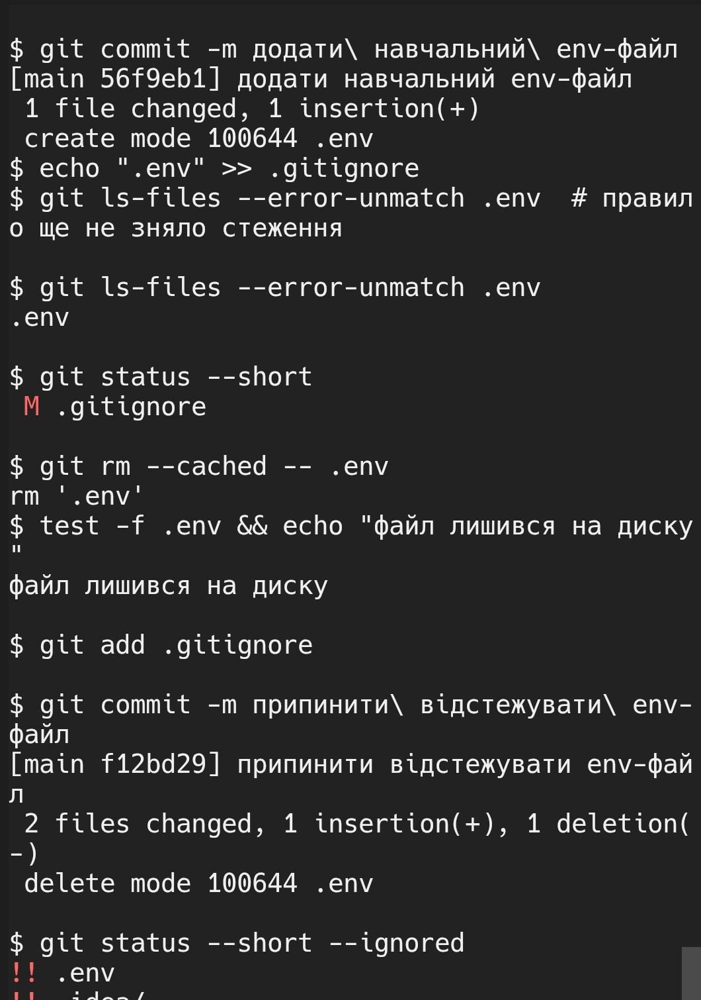

### 3. Шаблони й винятки

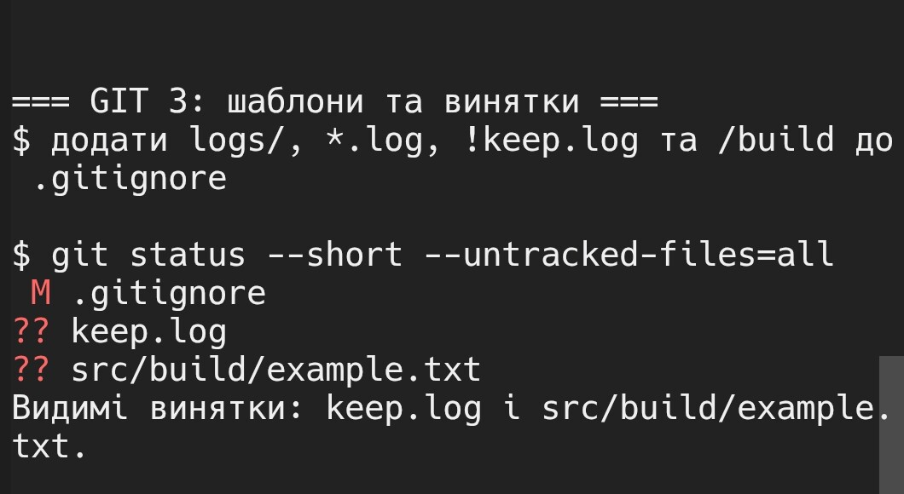

### 4. `git check-ignore` та безпечний `git clean`

Спершу показано `git clean -n`, потім — очищення лише навчального репозиторію.

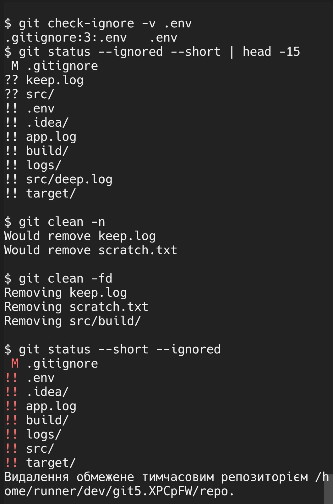

### 5. Відстеження файла у двох гілках

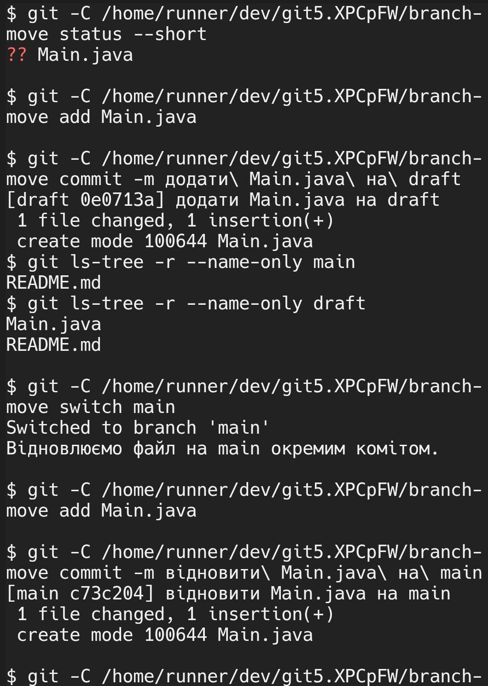

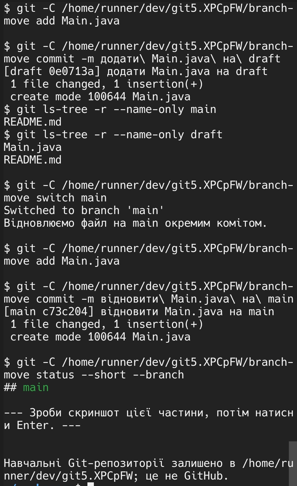
