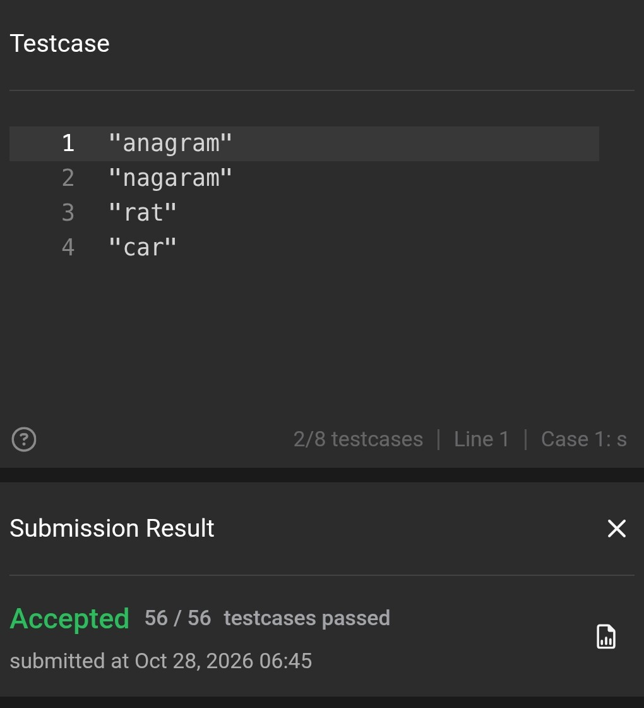
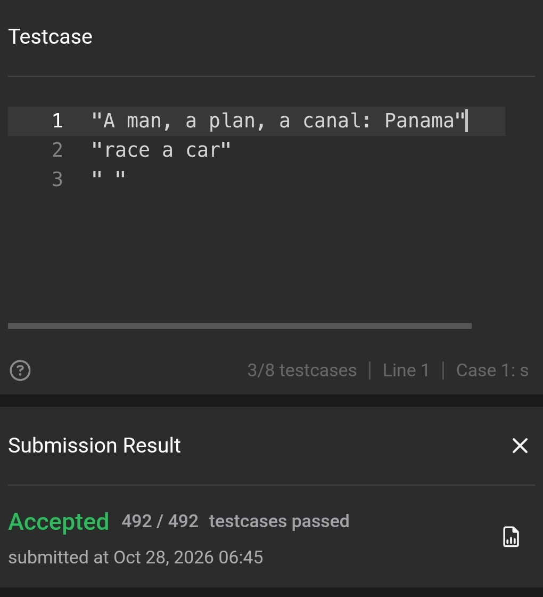

# Практична 6 — підтвердження виконання

Справжні скриншоти виконання обрізані до команд, їхнього виводу та результатів
LeetCode; панелі браузера й телефона прибрані. Текст усередині знімків не змінено.

## LeetCode 242 — Valid Anagram

**Accepted — 56/56 тестів.**



## LeetCode 125 — Valid Palindrome

**Accepted — 492/492 тестів.**



## DevOps

| Завдання | Підтвердження |
| --- | --- |
| 1. Програма та два процеси | [Файл `sleep` і два різні PID](../evidence/devops/practice-6/01-program-and-processes.jpg) |
| 2. Прочитати таблицю процесів | [PID, користувач, CPU, пам'ять і команда](../evidence/devops/practice-6/02-process-table.jpg) |
| 3. Звичайне та примусове завершення | [`Terminated` після `kill` і `Killed` після `kill -9`](../evidence/devops/practice-6/03-term-and-kill.jpg) |
| 4. Передній план, зупинка та продовження | [Переривання через SIGINT](../evidence/devops/practice-6/04-foreground-interrupt.jpg), [SIGTSTP, `fg`, `bg`, `Stopped` і `Running`](../evidence/devops/practice-6/05-stop-and-resume.jpg) |
| 5. HTTP-сервер | [Передній план і переривання](../evidence/devops/practice-6/06-http-foreground.jpg), [фон, перевірка PID і завершення](../evidence/devops/practice-6/07-http-background.jpg) |
| 6. Пошук і завершення за назвою | [`pgrep`, `pkill` і відсутність процесів після завершення](../evidence/devops/practice-6/08-pgrep-and-pkill.jpg) |
| 7. Навантаження системи | [Інтерактивний `top`: CPU](../evidence/devops/practice-6/09-top-interactive-cpu.jpg), [пам'ять](../evidence/devops/practice-6/10-top-interactive-memory.jpg), [читабельні колонки та два сортування](../evidence/devops/practice-6/11-top-readable-cpu-memory.jpg) |

### Що адаптовано для телефона

- Замість фізичних Ctrl+C та Ctrl+Z допоміжний процес надсилав SIGINT або SIGTSTP
  саме створеному навчальному процесу, який повертався на передній план через `fg`.
  Це демонстрація сигналів і керування завданнями, а не доказ натискання цих клавіш.
- HTTP-процес перевірявся допоміжною командою з того самого Shell, без другого
  термінала. На знімках сервер запущено з `~/workspace` та прив'язано до `127.0.0.1`.
- Для вправи з керуванням завданнями використано `sleep 300` замість `sleep 30`,
  щоб процес не завершився під час роботи з телефона.
- Коротка таблиця `ps -eo ... | head -10` містить заголовок і дев'ять процесів.
  Це читабельне представлення потрібних колонок, а не буквальний вивід `ps aux`.
- У вузькому інтерактивному `top` праві колонки не вмістилися. Додатковий знімок
  показує справжній вивід `top -b`, відсортований окремо за `%CPU` і `%MEM`;
  `awk` лише залишає PID, CPU, пам'ять та назву команди.
- `pgrep` і `pkill` обмежено дочірніми процесами поточного Shell (`-P "$$"`)
  та точним шаблоном, щоб не завершити сторонні процеси.

На додатковому знімку лідер CPU — `top` із 9,1%, лідер пам'яті — `node` із 5,9%.
Це значення на момент вимірювання, а не постійні характеристики.
Оригінальні команди та пояснення: [DevOps 6](devops-6.md).

## Git

Використано той самий персональний репозиторій курсу. Параметр
`git -C ~/dev/aop-practice-s1-java` явно обирає його незалежно від поточної теки
Shell. Помилковий знімок службової історії Replit не включено до підтверджень.

| Завдання | Підтвердження |
| --- | --- |
| 1. Варіанти журналу | [Повний формат комітів, короткий журнал і граф](../evidence/git/practice-6/01-log-views.jpg) |
| 2. Фільтри журналу | [Статистика, автор, дата й історія `readme.md`](../evidence/git/practice-6/02-log-filters.jpg) |
| 3. Хеш і відносне ім'я | [`git show 184c1be`](../evidence/git/practice-6/03-show-by-hash.jpg), [`git show HEAD~2`](../evidence/git/practice-6/04-show-relative.jpg) — однаковий коміт |
| 4. Походження рядка | [Автори, дати та хеші з `blame`](../evidence/git/practice-6/05-blame.jpg), [зміни README у знайденому коміті](../evidence/git/practice-6/06-show-readme.jpg) |
| 5. Пошук появи тексту | [`log -S "Практична 6"` знаходить `56e98bf`](../evidence/git/practice-6/07-pickaxe-search.jpg) |
| 6. Тег | [`tag: v1.0.0` у журналі](../evidence/git/practice-6/11-author-counts-and-tag.jpg) |
| 7. Власні формати | [Два формати журналу](../evidence/git/practice-6/09-custom-log-formats.jpg) |
| 8. Загальний огляд історії | [Граф `--all`](../evidence/git/practice-6/10-all-branches-graph.jpg), [кількість комітів за авторами](../evidence/git/practice-6/11-author-counts-and-tag.jpg) |

### Межі показаного виводу

Для читабельності на телефоні частину журналів показано з коротшими лімітами,
ніж у листку: зокрема два коміти у повному форматі, п'ять у першому графі та
один зі статистикою. Знімки довгих виводів можуть показувати лише їхні фрагменти.
У вправі `blame` файл називається `readme.md` малими літерами; для знайденого
коміту показано зміни саме цього файла. Повні довідкові команди:
[Git 6](git-6.md).

### Публікація тега

[Початковий push із мобільного Shell](../evidence/git/practice-6/08-tag-shell-push-error.jpg)
не пройшов авторизацію. Локальний тег при цьому створився.
Після цього тег успішно опубліковано через авторизований Git-транспорт агента;
перевірка віддаленого `refs/tags/v1.0.0` підтвердила цільовий коміт:

```text
f8223e75672cb232d76d08922e947c67b6a4b802
```

[Тег v1.0.0 у GitHub](https://github.com/vitaliivertiaiev-commits/aop-practice-s1-java/tree/v1.0.0).
Це закладка стану до додавання термінальних скриншотів: нові коміти не пересувають
тег автоматично. Успішна публікація агентом не означає, що авторизацію
користувацького Shell виправлено.
